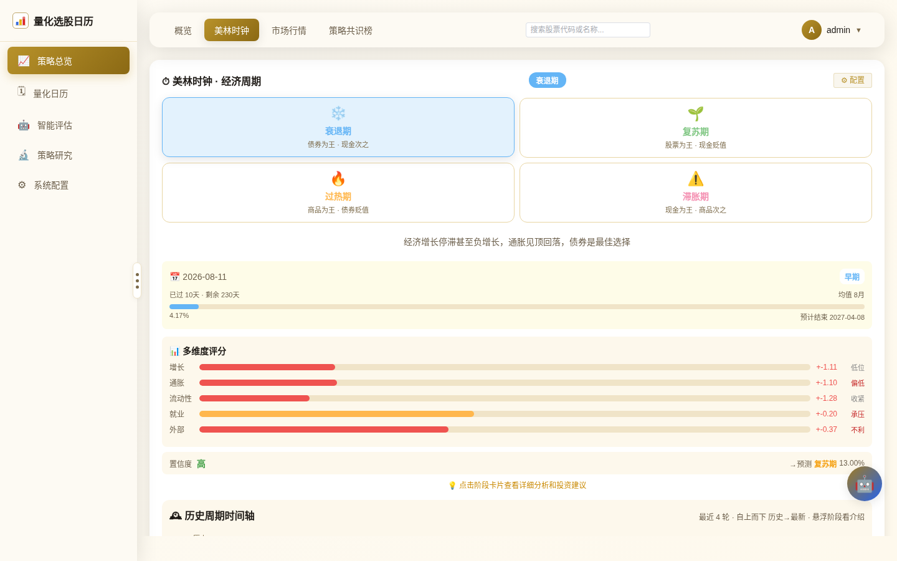
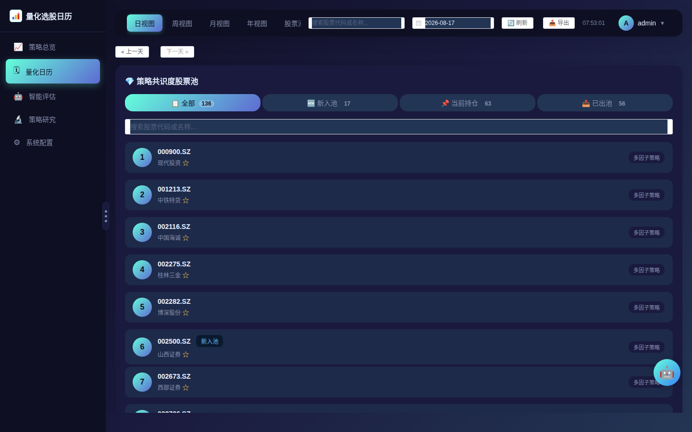
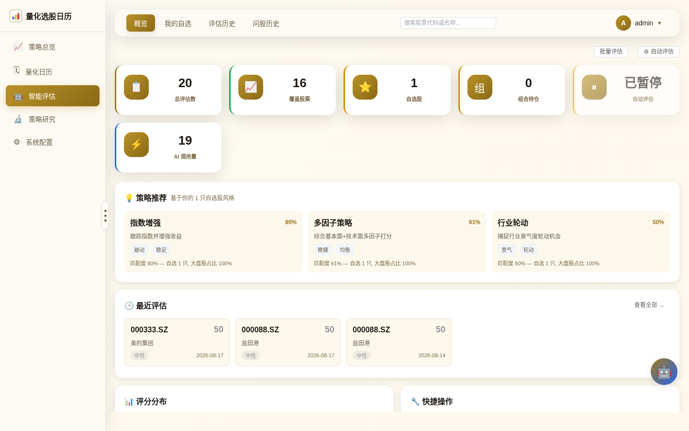
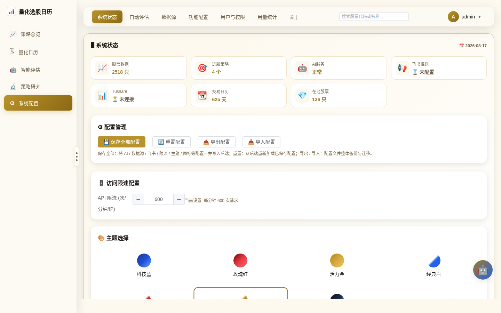
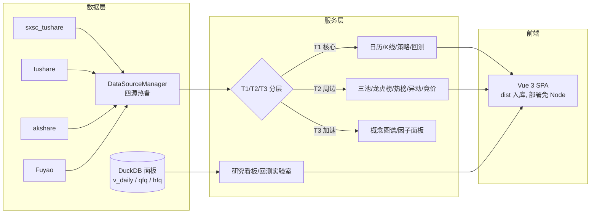

<p align="center">
  
  <h1 align="center">量化选股日历</h1>
  <p align="center">
    <strong>Quant Calendar</strong> — 宏观周期 · 多因子选股 · AI 评估 · 短线复盘 · 研究底座，一个本地运行的 A 股量化工作台。
  </p>
  <p align="center">
    <a href="https://github.com/bangbang8000-cell/quant-calendar/releases"></a>
    
    <a href="LICENSE"></a>
    
    
    
    <a href="https://github.com/bangbang8000-cell/quant-calendar/stargazers"></a>
  </p>
</p>

---

## 一句话

把「今天该看什么」做成一个日历：**宏观周期 → 策略选股 → AI 评估 → 短线复盘 → 研究验证**，全部本地跑、数据可追溯、口径写在页面上。

自 v6.7 起接入同花顺（Fuyao）数据平台，形成一条完整的数据产品线（v6.7 → v7.3），当前版本 **v7.3.1**。

| 维度 | 现状 |
|---|---|
| 数据源 | 四源热备 `sxsc_tushare → tushare → akshare → fuyao`，任一家挂掉自动降级 |
| 数据底座 | 本地 DuckDB 全市场面板：**10,368,988 行 / 5,577 只 / 10 年日 K + 复权因子** |
| 行业覆盖 | 同花顺行业 **320/320 全覆盖**，5/20/60 日横截面相对强度 |
| 质量门禁 | **4273 项测试全绿**、ruff、体积预算、静默异常、PIT 防未来函数审计、零 Fuyao 演练 |

---

## v7.3.0 交付了什么（数据产品线全景）

| 版本 | 主题 | 关键能力 |
|---|---|---|
| **v7.3.0** | 财务质量 · 审计 · 回测 | 六口径财务分位、**五项可执行防未来函数审计**、回测实验室（lag=1 + 双边成本 + 样本内外同参） |
| v7.2.0 | 情绪与资金结构 | 涨停情绪脉冲屏（早封率/封单留存/原因分布）、龙虎榜资金拓扑（概念等分·**守恒 diff=0**）、热榜—股价共振（Spearman） |
| v7.1.0 | 研究看板 | 行业强度作战矩阵、单文件离线 HTML 导出（断网可开）、口径禁称词表 + 四要素尾注 |
| v7.0.0 | 数据底座 | vendor 官方 `marketdb` + DuckDB 落盘、概念图谱、因子面板、`/api/dwh/*` |
| v6.9.0 | 盘中情绪与事件流 | 集合竞价四接口、同花顺热榜/飙升榜、异动解读（日 473 条分页）、事件源 provider |
| v6.8.0 | 短线数据正式化 | 三池字段合并（Fuyao 优先·本地补齐·`field_source` 溯源）、涨停原因直供、官方封板率/晋级率 |
| v6.7.0 | 数据接入 | Fuyao 客户端（令牌桶/重试/错误分类）、**三层数据分层 T1/T2/T3**、影子对拍、能力域三级开关 |

完整历史见 [docs/CHANGELOG.md](docs/CHANGELOG.md)。

---

## 功能地图

| 域 | 能力 | 入口 |
|---|---|---|
| 🧭 宏观研判 | 美林时钟五维度评分、周期四阶段判断、修正与快照 | 首页 / 宏观 |
| 📈 策略选股 | 动量 / 反转 / 质量 / 资金流四套策略、共识榜、入池出池统计 | 策略概览 |
| 🤖 AI 评估 | DeepSeek / OpenAI / 豆包等（OpenAI 兼容协议），技术指标自动注入，历史可追溯 | AI 评估 |
| 🗓️ 日历与行情 | 日/周/月/年视图、内置 K 线、多周期涨跌幅 | 量化日历 |
| 🔥 短线复盘 | 三池（涨停/炸板/跌停）、涨停原因、连板梯队、连板天梯、情绪脉冲 | 短线复盘 |
| 🧪 研究看板 | 行业强度矩阵、龙虎榜资金拓扑、热榜共振、离线单文件导出 | 短线复盘 · 概览 |
| 🗄️ 数据底座 | DuckDB 面板、复权视图 `v_daily_qfq/v_daily_hfq`、增量同步、7 天备份 | `/api/dwh/*` |
| 🛡️ 质量与审计 | PIT 审计五项、口径禁称守护、零源演练 | `/api/research/pit-audit` |
| ⚙️ 系统 | 数据源管理（密钥只从环境变量读）、飞书推送、监控 `/metrics`、开放 API Key | 系统配置 |

---

## 界面预览

<details open>
<summary><b>策略总览</b> — 今日一屏、共识榜、股票池</summary>
<p align="center"></p>
</details>

<details>
<summary><b>量化日历</b> — 日/周/月/年视图，内置 K 线</summary>
<p align="center"></p>
</details>

<details>
<summary><b>AI 评估</b> — 多模型串行评估，历史追溯</summary>
<p align="center"></p>
</details>

<details>
<summary><b>系统配置</b> — 数据源管理、飞书推送、AI 模型</summary>
<p align="center"></p>
</details>

---

## 快速开始

### Docker（推荐）

```bash
docker pull ghcr.io/bangbang8000-cell/quant-calendar:6.6.0
docker run -d --name quant-calendar -p 8000:8000 \
  -v "$PWD/data:/app/data" -v "$PWD/.env:/app/.env:ro" \
  ghcr.io/bangbang8000-cell/quant-calendar:6.6.0
```

> 镜像只对**关键版本**（`x.y.0`）构建，最近可用标签为 `6.6.0`；7.x 目前以源码方式部署。

### 源码安装

```bash
git clone https://github.com/bangbang8000-cell/quant-calendar.git
cd quant-calendar

# 依赖（只读部署可用 --target 装到工作区）
pip install -r requirements.lock

cp .env.example .env                       # 填 TUSHARE_TOKEN 等
python -m uvicorn backend.main_new:app --host 0.0.0.0 --port 8000
# 打开 http://127.0.0.1:8000
```

前端 `frontend/dist` 已入库，**部署不需要 Node**；修改前端后执行 `cd frontend && npx vite build`。

### 必配项

| 变量 | 用途 | 说明 |
|---|---|---|
| `TUSHARE_TOKEN` | 主数据源 | 必须真实值，否则行情/日线大面积降级 |
| `SXSC_TUSHARE_TOKEN` | 首选数据源 | 可选，缺失自动走 tushare |
| `FUYAO_API_KEY` | 同花顺数据平台 | **只从环境变量读取，不落配置文件**；缺失则周边能力自动回退 |
| `IWENCAI_API_KEY` | 涨停原因补充 | 可选（v6.8 起 Fuyao 优先、问财降级为补充） |
| `SECRET_REVEAL_PASSWORD` | 密钥查看 | 系统页查看完整 Key 时使用 |

首次登录请立即改密（弱口令会触发告警）。

---

## 架构



**数据分层是硬约束（不是建议）**：

- **T1 核心**（日历 / 日线与分钟线 / 策略 / 回测 / 每日指标）：**Fuyao 被显式禁止**，`T1_FORBIDDEN={'fuyao'}` 在路由处过滤，任何调用都不会把 Fuyao 排进 T1 链路。
- **T2 周边**（三池 / 龙虎榜 / 竞价 / 热榜 / 异动 / 新闻 / 概念 / 财务）：Fuyao 优先，本地源补齐，逐字段 `field_source` 溯源。
- **T3 加速**（概念图谱 / 因子面板）：只做加速，**永不是唯一路径**，不可用时回落逐票。

---

## 口径纪律

这是本项目刻意"不好看但诚实"的地方：

- **禁称词表**：`指数贡献 / 全市场晋级率 / 盘口成交 / 精确复权 / 买入信号 / 推荐买入 / 必涨` 一律拦截，导出物被守护拦下即失败（连"引用禁称解释禁称"都不允许）。
- **四要素尾注**：数据时间 / 来源 endpoint / 计算口径 / 非投资建议，缺一即不合格。
- **缺数不填 0**：字段缺失返回 `null` 并给出统计口径；空列表可能代表上游降级，会显式标注。
- **分位口径**：财务分位标注为「入参股票池样本内分位」，**不是全市场分位**。
- **回测不调参**：样本内外使用同一套参数，样本外衰减如实展示（v7.3 实测动量策略样本内 +0.19% → 样本外 −23.0%）。

---

## 质量与验证

| 门禁 | 内容 |
|---|---|
| 单元/集成测试 | `pytest -m "not e2e"` → **4273 passed / 1 skipped / 0 failed** |
| 代码风格 | `ruff check`（新增文件 0 告警） |
| 结构门禁 | 单文件 ≤700 行、前端源码体积预算、静默异常分级 |
| 前端门禁 | 一致性 / 令牌无硬编码 / 未定义类 / 组件对拍快照 |
| 防未来函数 | `/api/research/pit-audit` 五项检查：库新鲜度 / 因子滞后 / 未来字段 / 入参日期 / 导出尾注 |
| 零源演练 | `scripts/drill_zero_fuyao.py`（关掉全部 Fuyao 能力域后逐端点验证：核心可用 + 周边诚实降级） |

```bash
# 常用命令
pytest -m "not e2e" -q          # 全量
ruff check backend/ frontend/   # 风格
python3 scripts/drill_zero_fuyao.py --base http://127.0.0.1:8000 --token <jwt>
```

---

## API 速览

| 端点 | 说明 |
|---|---|
| `GET /api/health` · `GET /metrics` | 健康检查 / Prometheus 指标 |
| `GET /api/market/kline/{ts_code}` | 日线/分钟线（T1，永不走 Fuyao） |
| `GET /api/shortterm/pools` · `/lhb` | 三池 / 龙虎榜（含 `meta.source` / `include_st` 口径） |
| `GET /api/shortterm/auction` · `/hot-list` · `/anomaly` | 竞价聚合 / 热榜 / 异动解读 |
| `GET /api/events/flash` | 市场快讯（标题 + 摘要 + 原文跳转） |
| `GET /api/research/industry-strength` | 行业强度矩阵（缓存优先，`?refresh=1` 刷新） |
| `GET /api/research/industry-export` | 单文件离线 HTML 报告 |
| `GET /api/research/sentiment-pulse` · `/lhb-topology` · `/attention-resonance` | 情绪脉冲 / 资金拓扑 / 热榜共振 |
| `GET /api/research/fin-quality` · `/pit-audit` · `/backtest-lab` | 财务分位 / 审计 / 回测 |
| `GET /api/dwh/status` · `POST /api/dwh/refresh` | DuckDB 面板状态 / 刷新（admin） |

完整 OpenAPI 在 `/docs`（可由配置关闭）。

---

## 仓库结构

```
quant-calendar/
├── README.md                  ← 本文件（概览 + 最近版本）
├── DEPLOYMENT.md              ← 部署手册
├── docs/
│   ├── CHANGELOG.md           ← 完整版本历史
│   ├── wiki/                  ← 项目 Wiki（Markdown，随仓库分发）
│   ├── ACCEPTANCE-v*.md       ← 各版本验收记录（含线上实测数据）
│   └── PRD-* / DEV*-PLAN-* / TEST-PLAN-* / EVAL-*
├── backend/                   ← FastAPI（Python 3.10+）
│   ├── main_new.py            ← 入口 + APP_VERSION 单一来源
│   ├── data_sources/          ← 四源管理（含 _fuyao 客户端）
│   ├── data_tier.py           ← T1/T2/T3 分层与仲裁
│   ├── dwh/                   ← DuckDB 面板（adapter 是唯一允许 import vendor 处）
│   ├── shortterm/             ← 短线复盘（三池/天梯/龙虎榜/情绪）
│   ├── research 相关模块       ← 行业强度 / 导出 / 脉冲 / 拓扑 / 共振 / 财务 / 审计 / 回测
│   └── api/v1/                ← REST 路由
├── libs/marketdb/             ← vendor 官方 marketdb（附 VENDOR.md，含许可冲突记录）
├── frontend/                  ← Vue 3 SPA（Vite 构建，dist 入库）
├── scripts/                   ← 版本 bump / 演练 / Docker 清理等
├── tests/                     ← pytest 全量 4263 项
└── data/                      ← 本地数据（.gitignore，含 dwh/ 面板与备份）
```

---

## 文档导航

| 想了解 | 去哪里 |
|---|---|
| 安装、部署、备份、故障排查 | [DEPLOYMENT.md](DEPLOYMENT.md) · [Wiki: 运维与发布](docs/wiki/09-运维与发布.md) |
| 数据源怎么选、Fuyao 能做什么不能做什么 | [Wiki: 数据源与数据治理](docs/wiki/03-数据源与数据治理.md) |
| 短线复盘各指标怎么算 | [Wiki: 短线复盘](docs/wiki/04-短线复盘.md) |
| DuckDB 面板怎么建、怎么增量、怎么备份 | [Wiki: 数据底座](docs/wiki/06-数据底座DWH.md) |
| 回测为什么"不好看"、怎么验证没偷看未来 | [Wiki: 回测与审计](docs/wiki/07-回测与审计.md) |
| 完整版本历史 | [docs/CHANGELOG.md](docs/CHANGELOG.md) |
| 每个版本怎么验收的（含实测数据） | [docs/ACCEPTANCE-v7.3.0.md](docs/ACCEPTANCE-v7.3.0.md) 等 |

---

## 最近版本

| 版本 | 日期 | 变更 |
|------|------|------|
| **v7.3.1** | 2026-11 | **当前开发版本** — 修复短线复盘页整页空白（setup 作用域事故）+ 补齐四态面板标题 + 新增「setup 接线」静态门禁 |
| **v7.3.0** | 2026-11 | 财务质量分位 + 防未来函数审计五项 + 回测实验室（lag=1/双边成本/样本内外同参）+ 零 Fuyao 演练 |
| **v7.2.0** | 2026-11 | 情绪脉冲屏 + 龙虎榜资金拓扑（守恒 diff=0）+ 热榜—股价共振 + 自选异动扫描 |
| **v7.1.0** | 2026-11 | 行业强度矩阵（320/320 覆盖）+ 单文件离线导出 + 口径禁称词表 |
| **v7.0.0** | 2026-11 | DuckDB 数据底座（1036 万行/5577 只）+ 概念图谱 + DWH 接口 |
| **v6.9.0** | 2026-11 | 集合竞价 + 热榜 + 异动解读 + 事件流 |

更早版本见 [docs/CHANGELOG.md](docs/CHANGELOG.md)。

---

## 路线图

- ✅ 数据底座：本地 DuckDB 面板 + 复权视图 + 增量同步
- ✅ 研究看板：行业强度 / 资金拓扑 / 热榜共振 / 离线导出
- ✅ 质量与审计：PIT 审计、零源演练、口径禁称守护
- ⏳ 切主门槛：影子对拍台账需连续 5 个交易日达标后，短线三池才从「双源合并」切为「单源优先」
- ⏳ PostgreSQL 存储后端（可选替代 SQLite）
- ⏳ 因子库扩容（在 `backtest_lab` 加因子注册，而非调参）

---

## 免责声明

本工具仅用于数据分析和研究参考，**不构成任何投资建议**。所有选股结果、评分、回测与 AI 结论均基于历史数据的统计分析，不代表对未来收益的预测或保证。历史回测不代表未来表现。股市有风险，投资需谨慎，使用者应独立判断并自行承担投资风险。

---

## 贡献

欢迎 Issue / PR。请先读 [DEPLOYMENT.md](DEPLOYMENT.md) 与 [docs/wiki/08-开发与测试.md](docs/wiki/08-开发与测试.md)（含 TDD 节奏与门禁清单）。PR 要求：

- 不包含任何硬编码密钥（含测试夹具）
- 新增能力带测试，全量 `pytest -m "not e2e"` 必须 0 failed
- 涉及口径的文案必须过 `disclosure_terms` 守护

---

## 许可

MIT License — 详见 [LICENSE](LICENSE)。
`libs/marketdb/` 为第三方 vendor 代码，其许可与升级流程见 [libs/marketdb/VENDOR.md](libs/marketdb/VENDOR.md)。

---

## Star History

<a href="https://star-history.com/#bangbang8000-cell/quant-calendar&Date">
  <picture>
    <source media="(prefers-color-scheme: dark)" srcset="https://api.star-history.com/svg?repos=bangbang8000-cell/quant-calendar&type=Date&theme=dark" />
    <source media="(prefers-color-scheme: light)" srcset="https://api.star-history.com/svg?repos=bangbang8000-cell/quant-calendar&type=Date" />
    
  </picture>
</a>

---

<p align="center">
  <sub>数据可以不好看，但必须是真的 · Made for A-share quantitative investors</sub>
</p>
